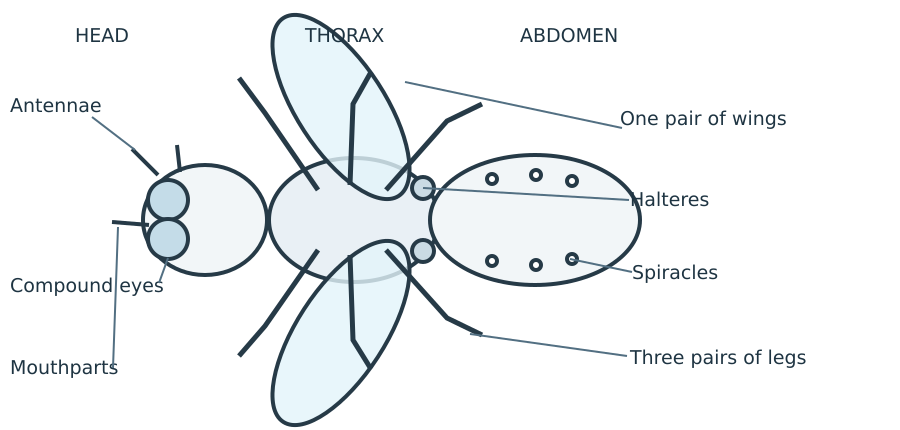

# Primary Six Science — The structure of a housefly

## An insect has three body regions
A housefly is an **insect**. It has no backbone. Its body is covered by a firm outer skeleton called an **exoskeleton**. An adult housefly has three main body regions: **head, thorax and abdomen**.

The **head** has two large compound eyes, short antennae and mouthparts. The eyes help it detect movement. The antennae sense its surroundings. The soft mouthparts take in liquid food.

The **thorax** carries three pairs of jointed legs (six legs in all), one pair of wings and a small pair of balancing organs called **halteres**. The halteres are modified hind wings. They help the fly balance while flying.

The **abdomen** contains many internal organs. Tiny openings called **spiracles** lead to breathing tubes. The fly breathes through this tube system, not through lungs like a mammal.

### Study the labelled drawing
The drawing shows the main external parts of an adult housefly. It is a simplified side-view teaching diagram, not a photograph.

## Compare insects with spiders
An adult insect has **six legs** and three body regions. A spider is an arachnid: it has **eight legs** and two main body regions. Wings are not present on all insects, but an adult housefly has one pair.

## Why houseflies matter
Houseflies can carry germs from dirty surfaces to food. Keep food covered, wash hands, use bins with lids and keep latrines and surroundings clean. Do not handle flies with bare hands during a class activity.

## Practice
1. Name the three body regions of a housefly.

   __________________________________________________________

2. How many pairs of legs does an adult housefly have? How many legs altogether?

   __________________________________________________________

3. Name the organs that help a housefly balance in flight.

   __________________________________________________________

4. Explain how a housefly breathes.

   __________________________________________________________

5. Give two differences between a housefly and a spider.

   __________________________________________________________

   __________________________________________________________

6. Label these parts on a sketch of a housefly: head, thorax, abdomen, one wing, one leg and compound eye.

   __________________________________________________________

   __________________________________________________________

7. State two ways of preventing flies from contaminating food.

   __________________________________________________________

   __________________________________________________________

8. A pupil says, “A housefly has two pairs of ordinary wings.” Correct the statement.

   __________________________________________________________
